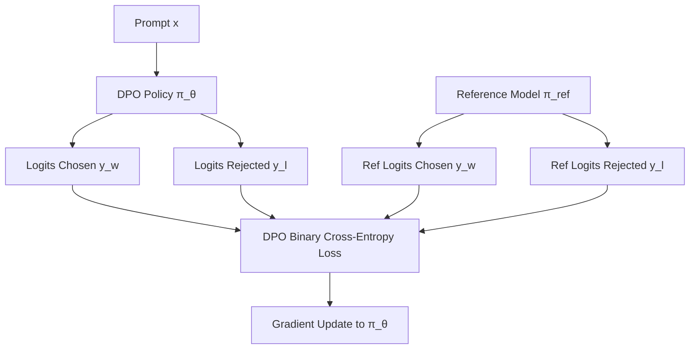

# Direct Preference Optimization (DPO)

Direct Preference Optimization (DPO) bypasses the need for training a separate reward model or using reinforcement learning loops.

## Workflow / Architecture

## Detailed Description
DPO shows that the policy network itself can serve implicitly as the reward model. By optimizing a binary cross-entropy loss directly on preference pairs $(x, y_w, y_l)$, DPO aligns the model to maximize the probability of preferred responses while minimizing the probability of rejected ones, regularized by a KL divergence term relative to the reference model.

[Back to README](../README.md)
