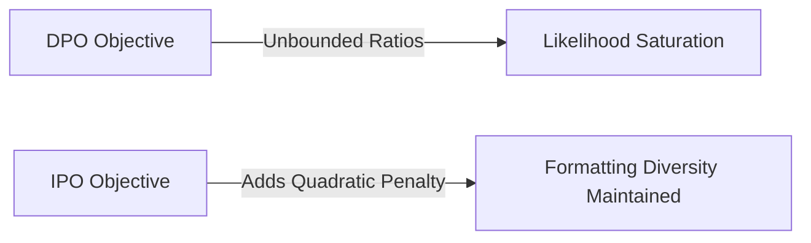

# Identity Preference Optimization (IPO)

IPO regularizes the log-likelihood ratios directly to prevent DPO from overfitting.

## Workflow / Architecture

## Detailed Description
IPO adds a root-mean-square regularizer directly to the optimization objective. This prevents the active policy from expanding its likelihood ratios to infinity, ensuring the model maintains formatting variety and does not collapse to deterministic outputs.

[Back to README](../README.md)
