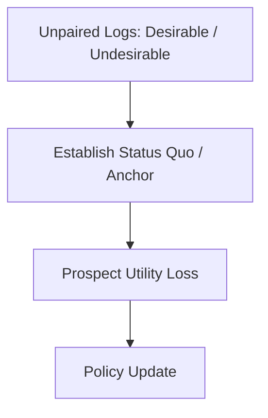

# Kahneman-Tversky Optimization (KTO)

KTO leverages Prospect Theory to optimize model utility directly from unpaired data.

## Workflow / Architecture

## Detailed Description
Unlike DPO, which requires paired chosen-rejected preferences, KTO treats inputs as standalone binary labels. It mirrors human utility perception, where losses are felt more keenly than equivalent rewards. This allows training directly on user logs (thumbs up / thumbs down).

[Back to README](../README.md)
