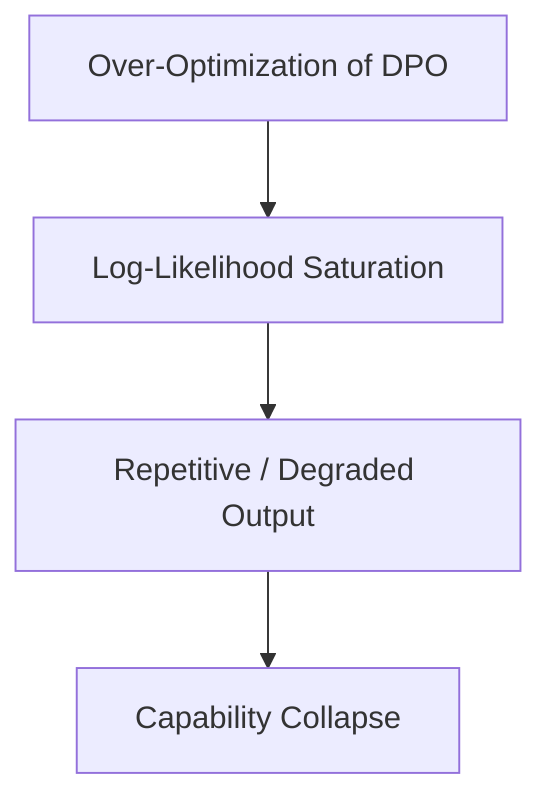

# Likelihood Saturation and Capability Collapse

Over-optimizing DPO objective functions leads to capability degradation.

## Workflow / Architecture

## Detailed Description
When DPO is optimized too far, the model excessively decreases the probability of rejected tokens, resulting in standard token prediction probability degradation. This manifests as repetitive text, format freezing, or incoherent outputs.

[Back to README](../README.md)
