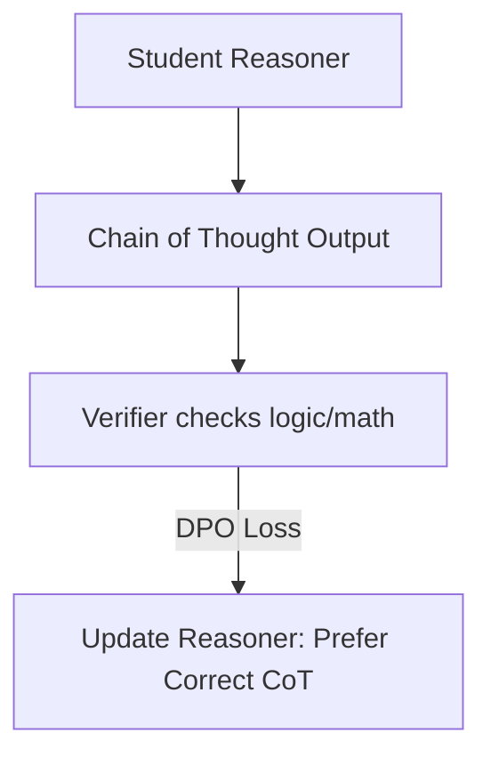

# Multi-Step Reasoning Refinement & Distillation

Applying preference optimization to chain-of-thought outputs.

## Workflow / Architecture

## Detailed Description
DPO is used to refine reasoning traces by prioritizing correct intermediate steps and self-correction loops while heavily penalizing logical lapses. This approach is key to distilling large reasoning models into smaller edge assistants.

[Back to README](../README.md)
