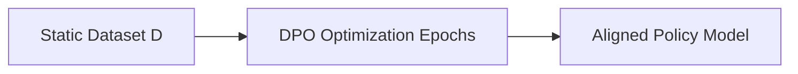

# Offline DPO (Static Framework)

The offline setting optimization pipeline utilizes static datasets.

## Workflow / Architecture

## Detailed Description
Offline DPO operates on fixed preference data collected beforehand. It is simple to implement but suffers from distribution shift as the policy changes and diverges from the data generator distribution.

[Back to README](../README.md)
