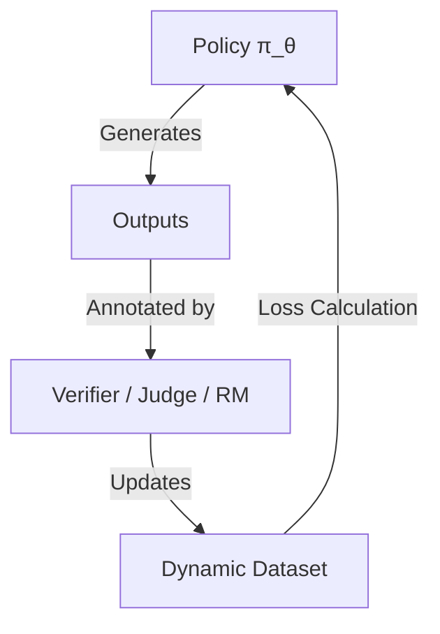

# Online / Iterative DPO

Online DPO samples and updates the preference data continuously during training.

## Workflow / Architecture

## Detailed Description
Online DPO dynamically generates preferences from the active model policy itself. This keeps the preference distribution aligned with the policy's distribution, avoiding the distribution shift problem of offline training.

[Back to README](../README.md)
