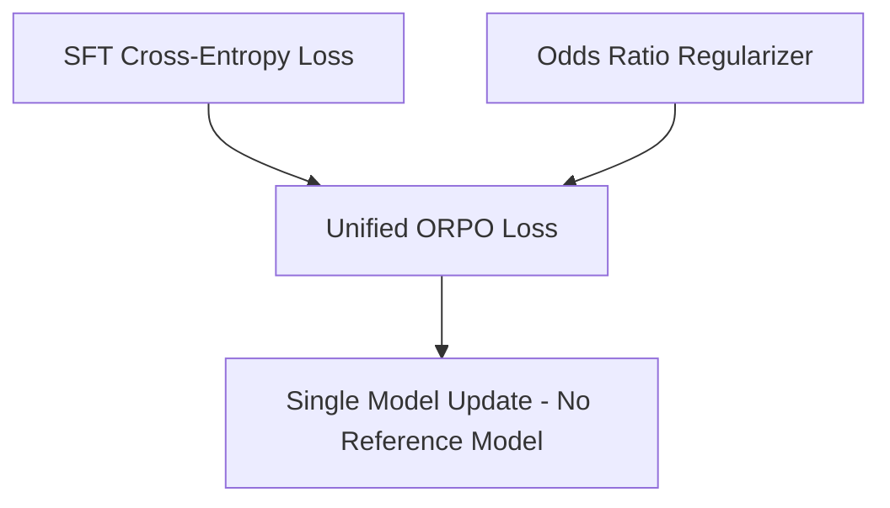

# Odds Ratio Preference Optimization (ORPO)

ORPO merges Supervised Fine-Tuning and alignment into a single monolithic step.

## Workflow / Architecture

## Detailed Description
ORPO eliminates the reference model entirely. It penalizes the generation of rejected tokens relative to chosen ones using token odds ratios directly alongside the standard supervised fine-tuning loss.

[Back to README](../README.md)
