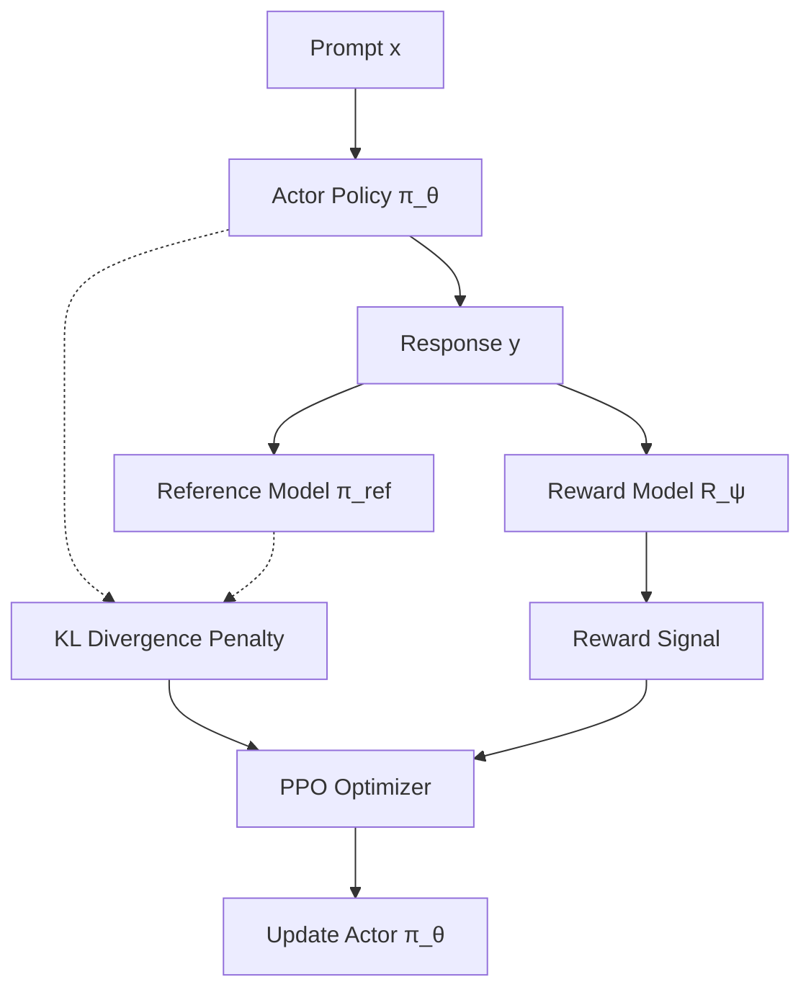

# The Actor-Critic RLHF Era (PPO Baseline)

Proximal Policy Optimization (PPO) was the standard reinforcement learning algorithm used for aligning Large Language Models from human feedback (RLHF) between 2019 and 2023.

## Workflow / Architecture

## Detailed Description
In the Actor-Critic RLHF setup:
1. **Actor Network ($\pi_	heta$):** The active language model policy generating text.
2. **Reference Network ($\pi_{	ext{ref}}$):** A frozen copy of the base model used to compute a KL divergence penalty, keeping the actor from drifting too far.
3. **Critic Network:** Estimates the state-value function to reduce variance in policy gradient updates.
4. **Reward Network ($R_\psi$):** Predicts human preference scores for generated outputs.

This system is complex, memory-intensive, and hard to stabilize due to the active coordination of four distinct models in memory.

[Back to README](../README.md)
