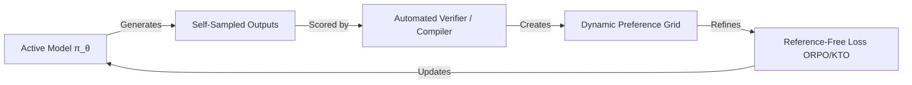

# Reference-Free & Iterative Online Era

The latest frontier in preference optimization shifts from static offline datasets to online self-correction and reference-free architectures.

## Workflow / Architecture

## Detailed Description
Modern optimization approaches remove the need for a static dataset. The model generates responses at runtime, which are automatically verified (by a LLM-as-a-judge, compiler, or unit test) to create immediate chosen/rejected preferences. These are optimized on the fly, often without needing a reference model in memory.

[Back to README](../README.md)
