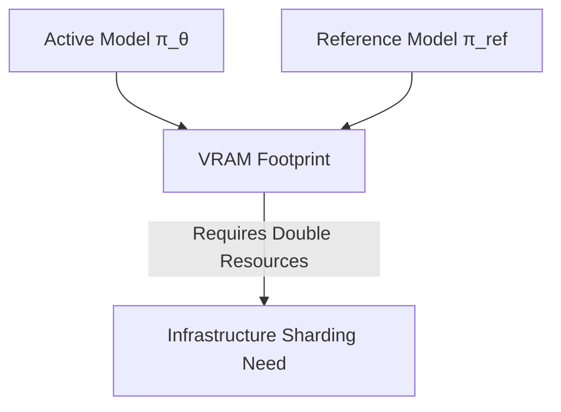

# The Reference Model Memory-Overhead Barrier

Holding two full models in GPU memory simultaneously restricts training scalability.

## Workflow / Architecture

## Detailed Description
DPO requires computing log-probabilities under both the target model and a frozen reference model. To mitigate this without doubling hardware costs, parameter-efficient architectures (like LoRA/QLoRA) are used, where only a lightweight adapter is trained while the base model weights serve as reference.

[Back to README](../README.md)
