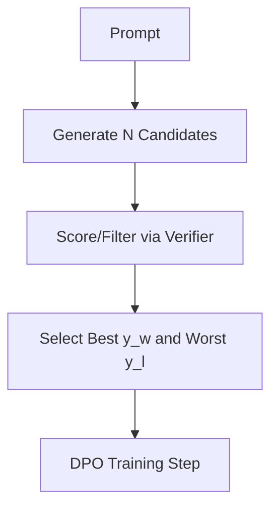

# Rejection-Sampling DPO

Rejection-Sampling DPO filters candidate generations to feed high-signal training pairs to DPO.

## Workflow / Architecture

## Detailed Description
For each prompt, the model samples multiple responses. A scorer filters the best and worst outputs, creating maximum-margin preference pairs. This focuses the training signals on clear distinctions, speeding up convergence.

[Back to README](../README.md)
