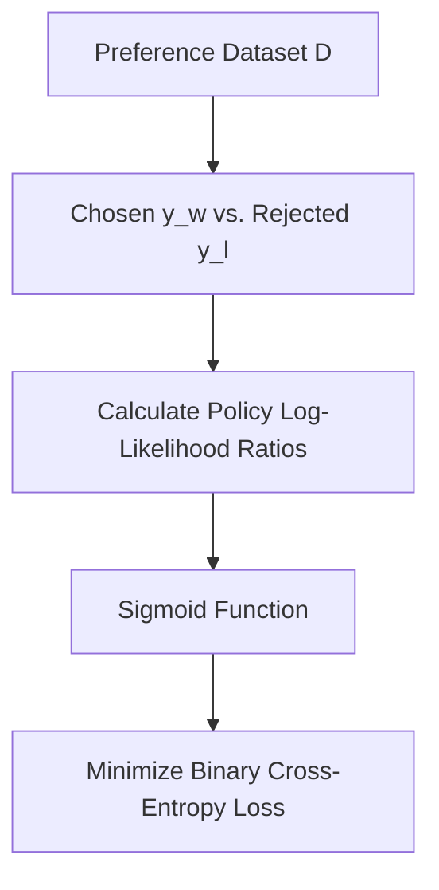

# Standard DPO (Bradley-Terry Formulation)

Standard DPO uses the Bradley-Terry preference model to directly optimize a policy.

## Workflow / Architecture

## Detailed Description
The loss formulation is:
$$\mathcal{L}_{	ext{DPO}}(\pi_	heta; \pi_{	ext{ref}}) = -\mathbb{E}_{(x, y_w, y_l) \sim \mathcal{D}} \left[ \log \sigma \left( eta \log rac{\pi_	heta(y_w|x)}{\pi_{	ext{ref}}(y_w|x)} - eta \log rac{\pi_	heta(y_l|x)}{\pi_{	ext{ref}}(y_l|x)} 
ight) 
ight]$$
This guarantees mathematical equivalence to RLHF under Bradley-Terry preferences.

[Back to README](../README.md)
